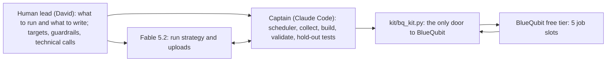

# Quantum Echoes: BlueQubit Midwest Quantum Hackathon 2026

OTOC echo estimation on 30 to 38 qubits by a human-led team of Claude agents. Human lead: David (solo entry). 24 hours, Nov 21 to 22, 2026.

**Final score: 2660 of 3000, 14th of 159 on the final leaderboard.** 70 entrants posted a score. Only 8 scored higher, and everyone tied at 2660 was ordered by total time. The team ran 761 BlueQubit jobs and made 21 uploads, all on the free tier.

| Problem | Size | Best | Estimator |
| --- | --- | --- | --- |
| S1, S2, S3 | 4 to 25 qubits | 300 / 300 | Exact statevector, locally |
| G1 | 30 qubits | 300 / 300 | Exact statevector on BlueQubit `cpu` |
| G2 | 36-qubit chain, 7,296 CZ, 2q depth 576 | 540 / 600 | MPS at χ = 24 on 32 sites, Pauli-path (δ = 1e-4) on q22 to q25 |
| G3 | 36 qubits, 6x6 grid, 1,512 CZ, 2q depth 176 | 720 / 800 | Pauli-path, δ = 1e-4, transpilation level 3 |
| G4 | 38 qubits, Echoes-style, 1,956 CZ, 2q depth 120 | 800 / 1000 | Pauli-path level 3, per-qubit Richardson extrapolation to δ → 0 |

Slides (PDF): [`docs/Quantum-Echoes-slides.pdf`](docs/Quantum-Echoes-slides.pdf). Every upload and its score, problem by problem, is in [`docs/results-by-problem.md`](docs/results-by-problem.md).

## The estimation problem

Each ID is one circuit and one observable: ⟨Z_q⟩ after running the circuit from |0…0⟩. The circuits are out-of-time-order echoes: a scrambling block U, an `x` kick on a butterfly qubit, then U†. Second order inserts a `z` on the probe qubit and repeats the echo. A qubit outside the butterfly's light cone returns to +1. Inside it, ⟨Z_q⟩ falls with how far the kick spread.

Score per circuit = ⌊10 · corr²⌋ / 10 × points, where corr² is the squared Pearson correlation against the exact values (0 if negative). It ignores scale and offset, and it is sensitive to sign and qubit order (qubit 0 is the rightmost Pauli letter). Because of the floor, only a full 0.1 jump in corr² changes the score, and the top tenth needs essentially exact values.

## Estimators and what each one showed

**Exact statevector.** BlueQubit's `cpu` device takes up to 34 qubits. That covered the samples and G1 (full marks) and nothing larger.

**Pauli-path.** Propagates Z_q backward through the circuit in the Heisenberg picture and drops Pauli strings whose coefficient falls below a threshold δ. Two findings carried most of the score:
- *Transpilation level matters more than δ.* At levels 0 and 1, whole qubits came back as exactly 0.0000: the truncation had removed every path for those qubits, so the zeros were "not seen" rather than physics. Level 3 rewrites the circuit before propagation and kept them. G3 q6, q7 and q28 went from about 0 to −0.618, −0.614 and +0.508, and the scores moved G3 from 320 to 720 and G4 from 400 to 700. Level 3 values on G3 held to within about 0.015 between δ = 1e-4 and 5e-5.
- *The δ floor is set per observable.* The server refuses a δ that is too small for a given ID, and the toolkit had priced every run on ID 0, whose floor is 7e-5. Priced per ID, 14 G4 qubits accepted 3e-5, 4 accepted 4e-5 and 2 accepted 5e-5.

**Truncation extrapolation (zero-noise-style).** On G4, each ⟨Z_q⟩ drifts in one direction as δ shrinks. For example, q10 reads −0.0120, −0.0229, −0.0267 and −0.0319 at δ = 2e-4, 1e-4, 8.5e-5 and 7e-5. Treating δ as the noise knob, a per-qubit linear fit through δ = 1e-4 and 7e-5, read at δ = 0 (Richardson order 1), produced the 800 file. A later measurement of q10 at 3e-5 read −0.0532, against the extrapolated −0.0529.

To choose fit forms without leaderboard feedback, held-out finer runs were predicted from coarser ones:

| Fit form, predicting the 3e-5 / 4e-5 values | RMS error | Mean bias |
| --- | --- | --- |
| log-linear in δ | 0.0039 | −0.0003 |
| √δ | 0.0042 | +0.0024 |
| quadratic in δ | 0.0043 | +0.0023 |
| linear in δ | 0.0055 | +0.0043 |

**MPS.** The free tier caps the bond dimension (χ = 24 on G2, 32 on G3 and G4; χ = 128 refused). On G2, a 1D chain, MPS at χ = 24 tracks most sites. Pauli-path alone scored 0 there: it pruned a 10-site block whose true values sit near 0.9. The hybrid uses each method where it held steady across settings, MPS on 32 sites and Pauli-path on q22 to q25, for 540. A χ = 20 to 24 hold-out showed the differences between χ values behave like noise (plain mean RMS 0.040, against 0.065 for a 1/χ trend), so χ-extrapolation could not recover the last tenth. On G3, MPS values flipped sign with χ and were dropped.

**Real hardware, assessed and ruled out.** With whole-circuit fidelity of roughly exp(−ε · N_CZ) at ε = 0.1 to 0.3%, G4 keeps about 14% down to 0.3% of its ±0.05 signal, and G2 keeps under 0.1%. Shot noise plus mitigation overhead puts near-exact values out of reach. BlueQubit's `quantum` device also returned no price on this account.

## The team: human lead and agents

The approach was inspired by Javier Mancilla's city of agents that code quantum computing, which he shared on LinkedIn. The question was what a small crew of AI agents, led by a human, could do on a real quantum estimation problem in 24 hours.



### Human lead
The agents did the legwork. The human lead directed the work and made the calls:
- **Directed both Claude sessions.** Told them what to run and what to write: which problems, settings and retries to run, and the handoffs, records, write-up, slides and this repo.
- **Scoring-driven targets.** Because the score floors corr² to a tenth, targets were set by bucket (G3 to 800, G4 to 900, total past 2700), with an upload bar of expected corr² ≥ 0.7 so uploads aimed at bucket jumps.
- **Noise framing.** Asked for zero-noise-extrapolation-style options, treating Pauli-path truncation as the noise to remove. That led to Richardson builds from each qubit's finest runs and to the hold-out test for fit forms. The first two-point extrapolation, 700 to 800, came just before.
- **Pushing past the limits.** Asking for G4 at 900 exposed the per-observable δ floors and put 20 qubits on finer thresholds.
- **Hardware pressure test.** Asked whether a real QPU could reach near-exact values, which produced the fidelity and gate-count estimate above and kept the work classical.
- **Leaderboard read.** Teams at 2720 had this entry's score plus a perfect G2, so the last push went to G2's MPS truncation.
- **Team and guardrail design.** One strategist, one runner and one API gateway, with a spend ledger, a $2 per-run cap, one submitter at a time, and a rehearsal of the whole pipeline the night before.

### Agents
- **Fable 5.2**, a Claude session, wrote run lines into a task file and made the uploads from Saturday evening on; the captain made the first five.
- **The captain**, Claude Code started in the kit folder under [`CLAUDE.md`](CLAUDE.md), held the API token, ran the scheduler, collected results, built and validated every CSV, ran the hold-out tests and logged each step.
- **Four specialist agents** in [`agents/`](agents) (circuit-scout, sample-tuner, job-runner, judge) rehearsed the pipeline on practice circuits the night before: 5 of 5 at corr² 1.0000.
- **[`kit/bq_kit.py`](kit/bq_kit.py)** is the only path to BlueQubit. It prices each run (now per ID), keeps the spend ledger, handles qubit order and holds a lock so only one process submits.

## Repository map

| Path | Contents |
| --- | --- |
| `CLAUDE.md` | Captain's brief: task, rules, phases |
| `agents/` | The four specialist agent briefs |
| `kit/` | `bq_kit.py` toolkit; local simulators (`sim_local.py`: exact, MPS, Pauli-path); offline practice backend (`fake_bq.py`, `make_rehearsal.py`); local control panel (`dashboard.py`, `dashboard.html`) |
| `scripts/` | Scheduler and slot helpers; file builders (`build_g4_richardson_finest.py`, `build_g4_at3e5.py`, `build_combined.py`); hold-out test (`g2_chi_holdout.py`); result watchers |
| `proxies/` | Local G2 and G4 test benches with reports |
| `results/best/`, `results/submitted/` | The best file per problem; all 21 uploaded files |
| `records/` | `submissions.md` (uploads and scores), `captain_log.md` (timestamped steps), `jobs.jsonl` (every job: setting, value, cost), scheduler log, rehearsal records |
| `docs/` | Slides as a PDF, full write-up, explainer page, slide deck source |

`CLAUDE.md` and `agents/` are the exact briefs the agents ran under during the event. "David" in them is the human lead.

## Running it

You need a BlueQubit account and your own API token.

```bash
pip install -r requirements.txt
export BLUEQUBIT_API_TOKEN=...      # your own token; the kit reads it and never prints it
python kit/bq_kit.py status
python kit/bq_kit.py estimate G4 --device pauli-path --opt th=3e-5 --opt level=3 --qubit 10
python kit/bq_kit.py run G4 --device pauli-path --opt th=1e-4 --opt level=3 --no-wait --max-cost 2
python kit/bq_kit.py collect
python kit/bq_kit.py validate G4 work/csv/G4__pauli-path_level3_th0.0001.csv
```

- `BQ_MODE=rehearsal` switches to the offline backend, and `kit/make_rehearsal.py` generates practice circuits.
- `python kit/dashboard.py` serves a local control panel on 127.0.0.1 with a per-launch key.
- The scripts in `scripts/` ran from the kit's `work/` folder and call `work/...` paths. To use them, copy them into `work/` next to `kit/`.

## Not included

No API token or credentials, no practice answer key, and no BlueQubit sample circuit files from the event.

## Lessons

1. Sweep transpilation levels on day one. Level 3 was worth 700 points across G3 and G4.
2. Read an exact 0.0000 from a truncated estimator as a diagnostic.
3. Extrapolate the approximation knob, and choose the fit form on held-out runs, never on leaderboard feedback.
4. Check server limits per observable, not per circuit.
5. Give agents hard rails: one gateway, a ledger, a per-run cap, one submitter.

## Next

Test a hybrid quantum and classical approach.

Released under the [MIT License](LICENSE).
