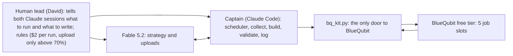

# BlueQubit hackathon: results by problem

BlueQubit Midwest Quantum Hackathon, Nov 21 to 22, 2026 (1:00 PM to 1:00 PM Phoenix). Human lead: David (solo entry), working with a team of Claude agents. Written 2026-11-22 at the close.

**Final: 2660 of 3000 points. $0 of the $30 coupon spent. 761 BlueQubit jobs, 21 uploads.** Final leaderboard: 14th of 159 (world view). 70 entrants posted a score. Only 8 scored higher; everyone tied at 2660 was ordered by total time.

Files in this repo:
- Best file for each problem: `results/best/`; all uploaded files: `results/submitted/`.
- Every upload and its score: `records/submissions.md`.
- Every step, timestamped: `records/captain_log.md`.
- Every job, its setting, value and cost: `records/jobs.jsonl`.

## The scoreboard

| Problem | Size | Best | Uploads | Best file | Method |
| --- | --- | --- | --- | --- | --- |
| S1 | 4 qubits | 100/100 | 1 | S1__exact_local.csv | Exact statevector on this Mac |
| S2 | 16 qubits | 100/100 | 1 | S2__exact_local.csv | Exact statevector on this Mac |
| S3 | 25 qubits | 100/100 | 1 | S3__exact_local.csv | Exact statevector on this Mac |
| G1 | 30 qubits | 300/300 | 1 | G1__cpu.csv | Exact statevector on BlueQubit `cpu` |
| G2 | 36-qubit chain, 7,296 CZ | 540/600 | 5 | G2__mps-chi24_pp-level0-1e-4-q22-25.csv | MPS chi 24 on 32 qubits, Pauli-path on q22 to q25 |
| G3 | 36 qubits, 6x6 grid, 1,512 CZ | 720/800 | 4 | G3__pp-level3_th1e-4.csv | Pauli-path, threshold 1e-4, transpilation level 3 |
| G4 | 38 qubits, Echoes style, 1,956 CZ | 800/1000 | 8 | G4__pp-level3_extrap-th0_from-1e-4-7e-5.csv | Pauli-path level 3, extrapolated to zero truncation |

Scoring: corr² between the submitted values and the exact ones, rounded down to the nearest 0.1, times the points. So 0.97 counts as 0.9, and a perfect score needs essentially exact values.

## The problem, in plain words

Each circuit is a quantum echo. It shuffles the qubits (a scrambling circuit U), kicks one "butterfly" qubit, then runs the shuffle backward. The second-order ones do this twice, with a flip on the probe qubit in between. For every qubit the task asks for ⟨Z⟩, which is how hard that qubit's coin leans to heads (+1) or tails (−1).

If the kick never reached a qubit, the backward shuffle puts it right back and it reads +1. The more the kick spread to it, the further it falls. The hard part: 36 to 38 qubits is too many to simulate exactly on the free tier, so every graded problem past G1 needed a shortcut.

The two shortcuts:
- **MPS** keeps a compressed copy of the state. Its quality knob is chi, like the quality setting on a JPEG. The free tier capped chi at 24 on G2 and 32 on G3 and G4.
- **Pauli-path** follows the measured qubit backward through the circuit, like a family tree, and prunes branches lighter than a threshold. Smaller threshold, less pruning, slower run. BlueQubit sets the smallest threshold it allows per qubit.

## Problem by problem

### S1, S2, S3 (samples, 100 each)
The samples came with their circuit files, so they were simulated exactly on a laptop and uploaded once each. All three scored 100 in the first 25 minutes.

### G1 (300 points)
30 qubits fits BlueQubit's exact `cpu` device, which takes up to 34. One exact run per qubit, free, uploaded at 1:38 PM: 300/300.

### G2 (600 points): two methods, each where it holds
| Time | Score | File and idea |
| --- | --- | --- |
| 4:01 PM Sat | 300 | MPS chi 16 on all 36 |
| 6:05 PM Sat | 0 | Pauli-path level 0 alone: it pruned a 10-qubit block whose values sit near 0.9 |
| 6:59 PM Sat | **540** | MPS chi 24 on 32 qubits, Pauli-path on q22 to q25 (best) |
| 11:54 AM Sun | 540 | Average of MPS chi 21 to 24 (a hold-out test picked the plain average over any trend) |
| 12:29 PM Sun | 540 | Last averaged file |

Why it stopped at 540: the next tenth needs corr² of about 1.0, which means exact values. MPS above chi 24 was refused for funds, exact `cpu` refuses 36 qubits, and paid devices were refused even with the coupon.

### G3 (800 points): exact zeros meant "not seen"
| Time | Score | File and idea |
| --- | --- | --- |
| 1:55 PM Sat | 80 | Pauli-path 1e-3: 29 of 36 values exactly 0 |
| 5:15 PM Sat | 320 | Level 0, finer thresholds on a few qubits |
| 10:57 PM Sat | **720** | Level 3 at 1e-4 on all 36 (best) |
| 11:50 AM Sun | 720 | Hybrid of levels 0/1 and level 3 |

The fix: asking BlueQubit to simplify the circuit first (transpilation level 3). Qubits 6, 7 and 28 came back near −0.62, −0.61 and +0.51 where levels 0 and 1 gave about 0. Finer thresholds (5e-5) confirmed the level 3 values held steady. MPS was dropped: its values flipped sign as chi changed.

### G4 (1000 points): extrapolating the truncation away
| Time | Score | File and idea |
| --- | --- | --- |
| 8:49 PM Sat | 400 | Pauli-path 1e-4, levels 0 and 1 |
| 10:13 PM Sat | 700 | Level 3 at 1e-4 |
| 12:05 AM Sun | 700 | Level 3 at 7e-5 |
| 9:55 AM Sun | **800** | Per-qubit straight line through 1e-4 and 7e-5, read at threshold 0 (best) |
| 10:14 AM Sun | 800 | Same idea, quadratic through 2e-4, 1e-4 and 7e-5 |
| 10:48 AM Sun | 700 | Log-linear fit read at 1e-5 (overshot) |
| 11:21 AM Sun | 700 | Measured 3e-5 values, others moved to 3e-5 |
| 12:23 PM Sun | 700 | Straight line through each qubit's two finest measured thresholds |

The idea behind 800 works like zero-noise extrapolation, with truncation playing the noise. Each value drifts steadily as the threshold shrinks, so the team drew a line through two thresholds and read it at zero. A later real run on qubit 10 at 3e-5 landed at −0.053, right where the line said zero was.

The finer runs only happened because of a kit fix: the toolkit had priced every run on qubit 0, whose floor is 7e-5. Priced qubit by qubit, 14 qubits accepted 3e-5, 4 accepted 4e-5 and 2 accepted 5e-5, so 20 qubits could run finer. Those runs took about 30 minutes each.

## How the system worked

The approach was inspired by Javier Mancilla's city of agents that code quantum computing, which he shared on LinkedIn.

- **The human lead (David)** told both Claude sessions what to run and what to write (which problems and settings to run, which retries to push, and the handoffs, records, write-up, slides and repo) and set the rules: ask before any run over $2, and upload G2 to G4 only when the expected score is above 70% of full points. The human lead also made the technical calls: scoring-driven targets, the zero-noise-style framing of truncation, the push past per-qubit limits, the real-hardware check and the leaderboard read (detailed in the README and on the deck’s steering slide).
- **Fable 5.2** (a second Claude session) chose what to run by writing lines into a task file, and made the uploads from Saturday evening on (the captain made the first five).
- **The captain** (Claude Code in the kit folder) held the API token, ran the scheduler, collected results, built and validated every CSV, ran the hold-out tests, and logged each step.
- **`kit/bq_kit.py`** is the only way any agent touches BlueQubit. It checks prices, keeps the spend ledger, handles qubit order (qubit 0 is the rightmost Pauli letter), and lets one submitter run at a time.
- **`work/scheduler.sh`** keeps the 5 free job slots busy from the task file, records refusals so they're never retried, and survives an empty task file.
- **The night before**, 4 specialist agents (circuit-scout, sample-tuner, job-runner, judge) rehearsed the whole pipeline on practice circuits and scored 5 of 5 at corr² 1.0000.

## Rules the team kept
- The API token never left the environment.
- No probing: site scores never set a weight or a value. Every upload was one method or a stated extrapolation, chosen by method reasoning or a hold-out test on the team's own runs.
- Every run was priced first and capped at $2. The scheduler had been passing a $10 cap; that was caught and set to $2 before the only paid-device test.
- "Solved using a quantum computer" stayed unchecked: everything was classical simulation.

## What the team learned
1. Try every transpilation level on day one. Level 3 was worth 700 points across G3 and G4.
2. An exact 0.0000 from Pauli-path is a warning sign.
3. Extrapolate the approximation knob, and test the form on a held-out run.
4. Check the server's limits per qubit, not once per circuit.
5. Real quantum hardware wouldn't have helped: BlueQubit's `quantum` device gave no price on this account, and at 1,956 to 7,296 two-qubit gates, noise would leave too little signal for near-exact values.

## Next
Test a hybrid quantum and classical approach.

## Explaining it

**To a non-technical listener (30 seconds):** "Each puzzle asked how a quantum computer would answer after scrambling its bits and unscrambling them. The real answers are too big to compute exactly, so the entry used two shortcut methods and a team of AI assistants, directed by a human lead, that ran 761 experiments over the 24 hours, all free. The best trick was noticing that the shortcut's error shrinks in a steady line, so the line could be followed to where the error would be zero."

**To a technical listener (30 seconds):** "OTOC echo circuits, 30 to 38 qubits, scored on corr² floored to 0.1. Samples and G1 exact. G2 is MPS at chi 24 with Pauli-path on four sites where MPS truncation broke down. G3 and G4 are Pauli-path with transpilation level 3, which recovered values that levels 0 and 1 pruned to zero. G4 adds per-qubit Richardson extrapolation in the truncation threshold, validated on held-out finer runs, never on leaderboard feedback."

## Related
- Slide deck source: `docs/slides/`
- Explainer page: `docs/explainer.html`
